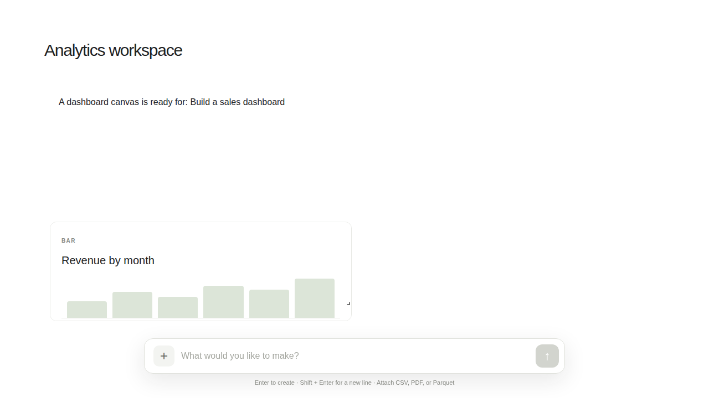

# The Canvasium

The Canvasium is a natural-language productivity canvas. The repository now includes a Turborepo + pnpm monorepo foundation for an AI-native Next.js workspace, a Fastify API, and shared Zod schemas. The earlier Vite/React prototype remains available through `legacy:*` scripts while the new app is scaffolded.

## Canvas renderer preview

The clean Canvasium workspace, ready for a document, dashboard, or visual prompt:



## Monorepo foundation

| Path | Purpose |
| --- | --- |
| `apps/web` | Next.js App Router UI, Tailwind, Zustand canvas state, Tiptap text blocks, and React Grid Layout |
| `apps/backend` | Fastify API with a validated starter planner endpoint |
| `packages/types` | Shared Zod schemas and TypeScript types for canvas state, content blocks, data sources, and plans |

The starter UI reacts to prompts with document, dashboard, or visual-workspace blocks. Document blocks flow as an editable page, while dashboard and visual blocks use a draggable/resizable grid. Visual prompts such as “Craft me a duck” display a deterministic local SVG preview, so they remain useful without an image-provider key. It includes editable Tiptap text and in-browser DuckDB schema inspection for CSV/Parquet files (PDFs retain metadata only). Fastify uses the local-first Ollama provider by default; the provider adapter supports optional commercial OpenAI-compatible services, with source schemas supplied as context. File contents remain in the browser; live chart queries, PDF extraction, provider-backed image generation, and SharePoint/Datalake connectors remain follow-up work.

The typed Vite canvas library and tracker described below remain available as a working prototype.

## Prototype capabilities

- **Typed canvas state:** Zod schemas define the normalized canvas, block types, widgets, modes, and data queries.
- **Atomic updates:** A batch of canvas operations either applies in full or leaves the existing state untouched. Untouched blocks retain their object identity.
- **Validated AI responses:** Accepts a decoded response or JSON text (including fenced JSON), validates its operations, and reports parse, JSON, or patch failures.
- **Reactive React renderer:** `CanvasRenderer` subscribes to canvas mode and ordering; each block subscribes to itself so sibling updates do not cause unnecessary block renders.
- **Pluggable data connectors:** A small connector interface supports injected DuckDB executors, Microsoft Graph, vector search, or your own data source.
- **Custom app blocks:** Register React components by `appId` and render them as canvas blocks.

## Prototype project layout

| Path | Purpose |
| --- | --- |
| `src/schema` | Canvas, block, widget, query, and AI-operation schemas |
| `src/state` | Atomic operation reducer and external canvas store |
| `src/router` | AI response parsing, validation, and dispatch |
| `src/connectors` | Connector interface, registry, and DuckDB/Graph/vector adapters |
| `src/ui` | React context, renderer, block components, and connector-query hook |
| `server` | Node API, storage, template planner, AI provider adapter, tracker queries |
| `src/demo`, `src/tracker` | Prompt workspace and tracker UIs |
| `test` | Tests for validation, patching, atomicity, and rendering |

## Prototype surfaces

| Surface | URL | What it does |
| --- | --- | --- |
| **Prompt workspace** (frontend) | `/` | A chat-style prompt panel for any productivity goal. Send a prompt with the arrow button; the conversation and generated workspace appear above it. **My History** shows saved prompts for the selected workspace. **How It Works** explains the app and includes canvas mode controls. |
| **Productivity tracker** (backend UI) | `/tracker` | A Canvasium dashboard of everything done through the app: prompts, success rate, workspaces, blocks, activity by day and category, and recent activity. Auto-refreshes every 15 seconds. |

The prototype's Node server (`server/`) serves both pages and a JSON API, records every prompt as a tracked event, and stores data in `data/canvasium.json`.
Open **How It Works** and use its **Canvas mode** controls to switch the generated workspace between Dashboard, Document, and App layouts. Modes affect the presentation of blocks; they do not erase workspace content.

## Run in GitHub Codespaces

Choose **Code → Codespaces → Create codespace**. The dev container installs the pinned pnpm version and frozen workspace lockfile, then forwards the Next.js workspace on port `3000` and API on port `3001`.

```sh
pnpm dev
```

Open the forwarded **The Canvasium workspace** port. Keep `pnpm dev` running in that terminal. In a second terminal, verify the live app and API proxy:

```sh
pnpm codespaces:smoke
pnpm typecheck
pnpm test
pnpm build
```

The smoke check sends a deterministic offline prompt, so it does not need an API key or call an external model. Attach a CSV/Parquet file in the browser to test local DuckDB schema inspection. Run `pnpm legacy:dev` to open the existing prototype on port `5173` and its tracker at `/tracker`.

## Local-first AI architecture

Canvasium uses an **open-source-first, provider-neutral AI runtime**. The default planner runs against a locally hosted [Ollama](https://ollama.com/) instance, so a fresh installation does not need a commercial LLM account or API key.

### AI provider layer

The Fastify backend calls a provider adapter rather than a vendor-specific model directly.

| Mode | Provider | Configuration | Purpose |
| --- | --- | --- | --- |
| Local (default) | Ollama | `AI_PROVIDER=ollama` | Private/local inference using open models |
| Commercial-ready | OpenAI-compatible API | `AI_PROVIDER=openai` | Optional hosted model integration |
| Compatible endpoint | OpenAI-compatible API | `AI_PROVIDER=openai-compatible` | Future hosted or self-managed endpoints |

The initial local model default is `qwen2.5:7b`. Other Ollama models can be selected with `AI_MODEL`, for example `llama3.1:8b`, `mistral:7b`, or another model supported by your Ollama installation. Model availability and hardware requirements depend on the model you pull.

### Install and run the local LLM

1. Install Ollama from [ollama.com](https://ollama.com/).
2. Start the Ollama service.
3. Pull a model:

```sh
ollama pull qwen2.5:7b
```

4. Copy the environment template and keep the default local settings:

```sh
cp .env.example .env
# AI_PROVIDER=ollama
# AI_MODEL=qwen2.5:7b
# OLLAMA_BASE_URL=http://127.0.0.1:11434/v1
```

5. Start Canvasium:

```sh
pnpm install
pnpm dev
```

Ollama must be reachable from the backend process. In Docker or a remote deployment, replace `127.0.0.1` with the Ollama service hostname or private endpoint. Do not expose Ollama's unauthenticated local port directly to the public internet.

Without a reachable model, use the explicit offline header for deterministic starter plans; a configured but unavailable LLM returns a provider error rather than silently pretending that AI inference succeeded.

### Enable a commercial LLM later

The provider boundary is already prepared for OpenAI-compatible commercial endpoints. To opt in, configure server-side secrets:

```env
AI_PROVIDER=openai
AI_API_URL=https://api.openai.com/v1
AI_API_KEY=your_server_side_key
AI_MODEL=gpt-4o-mini
```

For another OpenAI-compatible service, set `AI_PROVIDER=openai-compatible`, provide its base URL in `AI_API_URL`, and supply its key in `AI_API_KEY`. Restart the backend after changing configuration. The browser never receives provider credentials. Commercial image generation remains an optional OpenAI-specific capability and is not required for local text planning.

### MCP (Model Context Protocol)

Canvasium exposes an MCP Streamable HTTP endpoint at:

```
POST http://localhost:3001/mcp
```

The initial MCP tool is `canvas_plan`, which accepts a natural-language prompt and optional connected-source metadata and returns a validated Canvasium plan. The endpoint supports MCP initialization, ping, tool discovery, and tool invocation using JSON-RPC.

Set `MCP_ENABLED=false` to disable the endpoint. Set a strong `MCP_API_KEY` before allowing remote MCP clients; clients authenticate with `Authorization: Bearer <key>`. Keep the endpoint on a private network and place it behind TLS and an authenticated gateway when deployed. Only expose tools that have explicit authorization and input validation.

Example MCP initialization request:

```json
{
  "jsonrpc": "2.0",
  "id": 1,
  "method": "initialize",
  "params": {
    "protocolVersion": "2025-03-26",
    "capabilities": {},
    "clientInfo": { "name": "canvasium-client", "version": "1.0.0" }
  }
}
```

### Versioned REST API

The backend also exposes stable integration endpoints:

| Method | Endpoint | Purpose |
| --- | --- | --- |
| GET | `/api/v1/health` | API health check |
| GET | `/api/v1/capabilities` | Runtime, provider, MCP and module discovery |
| POST | `/api/v1/plan` | Generate a validated workspace plan |
| POST | `/mcp` | MCP JSON-RPC over Streamable HTTP |

The existing `POST /api/plan` endpoint remains available for compatibility. The versioned plan endpoint accepts the shared `PlanRequestSchema` payload. Keep the Fastify service private behind the Next.js application or an authenticated API gateway; set the same non-empty `INTERNAL_API_SECRET` for the Next.js proxy and backend in production.

### Ready-mode integration modules

Canvasium is structured to add capabilities without coupling the canvas UI to a provider or integration vendor. The backend capability registry currently advertises these integration areas:

| Module | Current state | Integration contract |
| --- | --- | --- |
| Canvas planner | Available | Validated prompt-to-canvas plan |
| Local LLM | Available with Ollama | OpenAI-compatible local inference |
| Commercial LLM | Adapter-ready | Server-side provider URL, key and model |
| MCP tools | Initial tool available | MCP tool discovery and invocation |
| Data connectors | Existing framework | Connector registry and source metadata |
| Vector search | Existing adapter interface | Injected vector-index implementation |
| Image generation | Local SVG fallback; commercial adapter optional | Provider-backed asset generation |
| External APIs | Ready for extension | Versioned REST endpoints and connector adapters |

“Ready” means the integration boundary and extension point are defined; it does not mean every external service is already implemented or connected. Future modules should be independently configurable, disabled by default until credentials and permissions are supplied, and validated at the backend boundary.

### AI security principles

- Keep LLM keys, MCP credentials and external API secrets on the server.
- Do not send uploaded file contents to the model by default; the planner receives source metadata and schemas only.
- Validate all model output with `CanvasPlanSchema` before applying it to a workspace.
- Require explicit authorization and least-privilege scopes for MCP tools and external connectors.
- Keep MCP and backend endpoints private unless protected by TLS, authentication, rate limits and audit logging.
- Record provider/model selection and request outcomes without logging secrets or unnecessary prompt content.

## Google sign-in and administration

Canvasium uses Google sign-in through Auth.js and stores users, sessions, and planner settings in PostgreSQL. Set `DATABASE_URL`, `AUTH_SECRET`, `AUTH_GOOGLE_ID`, and `AUTH_GOOGLE_SECRET` in `.env` (`openssl rand -base64 32` generates an `AUTH_SECRET`), then run:

```sh
pnpm db:up
pnpm db:migrate
```

In Google Cloud, add `http://localhost:3000/api/auth/callback/google` and the production equivalent as authorized redirect URIs. Set `ADMIN_EMAILS` to a comma-separated allowlist; only those accounts can open `/admin` to enable or disable the planner and select its OpenAI model. API keys stay in server secrets. Set the same non-empty `INTERNAL_API_SECRET` for Next.js and Fastify in production so only the authenticated Next.js proxy can call the planner.

## MVP production checklist

After Google sign-in and PostgreSQL are configured, Canvasium persists one private canvas per user and records prompt outcomes for rate limiting and audit history. The planner permits 20 authenticated requests per minute per user. Local CSV/Parquet dashboards query the attached file with DuckDB-Wasm and render their first numeric series in the browser; files are never uploaded to the server and must be reattached after a page reload.

The default structured planner uses local Ollama inference. Configure `AI_PROVIDER=openai` and server-side `AI_API_KEY` to opt into commercial OpenAI planning. OpenAI Images (`OPENAI_IMAGE_MODEL`, default `gpt-image-1`) is an optional commercial-only visual capability; local SVG previews remain available without it. Failed image-provider requests are returned as errors rather than silently claiming an image was generated.

Set `SENTRY_DSN` for server errors and `NEXT_PUBLIC_SENTRY_DSN` for browser errors. Before deployment, set `AUTH_TRUST_HOST=true`, a strong `AUTH_SECRET`, and `INTERNAL_API_SECRET`; configure all values as deployment secrets. Run `pnpm db:migrate` during release, keep Fastify private behind the Next.js app, and use the provided health endpoint for hosting checks.

The legacy Vite prototype can also use any OpenAI-compatible chat-completions endpoint through `AI_API_URL`, `AI_API_KEY`, and `AI_MODEL`:

```sh
AI_API_URL=https://api.openai.com/v1/chat/completions
AI_API_KEY=your-key
AI_MODEL=gpt-4o-mini
```

Keys stay on the server. Model output is validated before it changes a workspace; invalid output is rejected (422), provider failures return 502, and both are tracked. Other settings: `PORT` (5173), `HOST` (127.0.0.1), `DATA_FILE` (`data/canvasium.json`).

## Legacy prototype API

| Endpoint | Purpose |
| --- | --- |
| `GET /api/health` | Health check |
| `GET /api/workspaces` | List workspaces |
| `GET /api/workspaces/:id` | Load a workspace canvas |
| `GET /api/workspaces/:id/history` | Load the most recent 50 prompt events for a workspace |
| `POST /api/prompt` | `{ "workspaceId", "prompt" }` (JSON, max 4000 chars) → updated canvas |
| `GET /api/tracker/:statement` | Tracker queries: `prompts`, `success-rate`, `workspaces`, `blocks`, `recent-activity`, `by-category`, `by-day`, `workspace-list` |

**Security:** there is no authentication, and the server binds to `127.0.0.1` by default. Don't expose it publicly without adding auth.

The new Fastify service exposes `GET /health` and `POST /api/plan`. The Next.js app proxies `/api/*` to Fastify on port `3001`. This API is unauthenticated; keep forwarded Codespaces ports private and add authentication before public deployment.

## Run locally

```sh
git clone https://github.com/roime81/The-Canvasium.git
cd The-Canvasium
pnpm install
pnpm dev                 # Next.js on :3000 and Fastify on :3001
pnpm build
pnpm typecheck
pnpm test                # Existing Vite prototype tests
pnpm legacy:dev          # Existing Vite prototype on :5173
```

The legacy Canvasium library public API is exported from `src/index.ts` and includes `StaticConnector`, `HttpConnector`, `renderBasicMarkdown`, and `CanvasStore.replace`.

## Downloadable Windows desktop app

The Electron desktop app is self-contained: it keeps the canvas in the current Windows user's application-data folder and does not require Google sign-in or PostgreSQL.

### Download and run

1. Open the repository's **Releases** page and download either the Windows installer (`The Canvasium Setup ... .exe`) or portable ZIP (`The Canvasium ... win.zip`).
2. Run the installer, or extract the ZIP and open `The Canvasium.exe`.
3. Use the prompt bar immediately with deterministic local plans. Your local canvas is saved automatically.

The first downloadable files are produced by **Actions → Desktop release → Run workflow**. After the workflow finishes, download them from its **Artifacts** section; publishing a `desktop-v*` tag also attaches them to a GitHub Release.

### Use an optional OpenAI key

To opt into commercial OpenAI text planning and image generation, create `%APPDATA%\\The Canvasium\\.env` after the first launch:

```env
AI_PROVIDER=openai
AI_API_URL=https://api.openai.com/v1
AI_API_KEY=your_openai_api_key
AI_MODEL=gpt-4o-mini
OPENAI_IMAGE_MODEL=gpt-image-1
```

Restart the desktop app after changing this file. Without a key it continues to work with deterministic local plans.

### Build a release

Maintainers can generate the Windows `.exe` installer and portable `.zip` on Windows with:

```sh
pnpm install --frozen-lockfile
pnpm desktop:dist
```

The **Desktop release** GitHub Actions workflow publishes both artifacts for every `desktop-v*` tag.

## How to use

Create a `CanvasStore`, provide a `ConnectorRegistry` and app registry through `CanvasProvider`, then render `CanvasRenderer`. Use `routeAIResponse` to validate and apply canvas operations:

```tsx
import {
  CanvasProvider,
  CanvasRenderer,
  CanvasStore,
  ConnectorRegistry,
  createEmptyCanvas,
  routeAIResponse,
} from "./src";
import { createRoot } from "react-dom/client";

const store = new CanvasStore(createEmptyCanvas("workspace"));
const connectors = new ConnectorRegistry();

const result = routeAIResponse(store, {
  ops: [
    {
      op: "add_block",
      block: {
        id: "welcome",
        type: "text",
        content: "Welcome to your canvas.",
      },
    },
  ],
});

if (!result.ok) {
  throw new Error(result.error);
}

const root = document.getElementById("root");
if (!root) throw new Error('Missing element with id "root"');

createRoot(root).render(
  <CanvasProvider env={{ store, connectors, apps: {} }}>
    <CanvasRenderer />
  </CanvasProvider>,
);
```

`CanvasProvider` requires a `CanvasStore`, a `ConnectorRegistry`, and an app-component registry. Register data connectors for dashboard queries and React components for custom app blocks. You can optionally provide `renderMarkdown` to render markdown-formatted text blocks; without it, text is displayed as pre-wrapped text.

## Applying AI operations

`routeAIResponse(store, raw)` accepts an object or JSON string with an `ops` array. The optional `intent` and `message` fields can carry application-level context. For example:

```json
{
  "intent": "Create a project dashboard",
  "ops": [
    {
      "op": "add_block",
      "block": {
        "id": "projects",
        "type": "dashboard",
        "columns": 12,
        "widgets": [
          {
            "id": "active-projects",
            "kind": "metric",
            "title": "Active projects",
            "span": 4,
            "query": {
              "connector": "duckdb",
              "statement": "SELECT COUNT(*) AS value FROM projects",
              "params": {}
            }
          }
        ]
      }
    }
  ]
}
```

Supported operations are `add_block`, `update_block`, `remove_block`, `move_block`, `upsert_widget`, `remove_widget`, and `set_mode`. A response may contain up to 100 operations. On failure, the result has `ok: false` and a `stage` of `json`, `parse`, or `patch`; the store is not partially updated. For direct state changes, use `store.dispatch(ops)`, which throws `PatchError` if an operation cannot be applied.

## Blocks and widgets

The built-in block types are:

- **`text`** — plain or markdown-formatted content.
- **`dashboard`** — a 1–12 column grid of metric, table, or chart widgets. Metric widgets show the first value in the first returned row; table and chart widgets currently render tabular results.
- **`app`** — a custom React component selected by `appId`; the component receives its `AppBlock` as a `block` prop.

Widgets can define a `query` with a connector ID, statement, and parameters. `useConnectorQuery` runs the query, exposes loading/error/ready states, and aborts an in-flight request when its query changes or the component unmounts.

## Data connectors

Implement `DataConnector` and register it with the `ConnectorRegistry`. A connector returns column names and rows:

```ts
import { ConnectorRegistry, DuckDbConnector } from "./src";

const connectors = new ConnectorRegistry().register(
  new DuckDbConnector(async (_sql, _params) => {
    // Call your DuckDB runtime here.
    return {
      columns: ["value"],
      rows: [{ value: 42 }],
    };
  }),
);
```

Included adapters:

- **`DuckDbConnector`** delegates SQL and parameters to an injected executor; choose and initialize the DuckDB runtime in your application.
- **`GraphConnector`** calls Microsoft Graph paths with a token supplied by your application.
- **`VectorSearchConnector`** adapts an injected vector index; `params.topK` sets the result count (default `5`).

Connectors own their runtime and authentication setup. The Canvasium does not ship a database, Graph credential flow, vector index, AI model client, or markdown renderer.

## Extending the canvas

To add a block type, add it to the discriminated `BlockSchema` in `src/schema/canvas.ts` and handle it in `renderBlock` in `src/ui/CanvasRenderer.tsx`. The renderer's exhaustive switch makes an unhandled block type a TypeScript error. Update the operation schema/reducer if the new block needs additional editable fields, and add tests for its validation and rendering.

## Development

```sh
npm run typecheck
npm test
```
