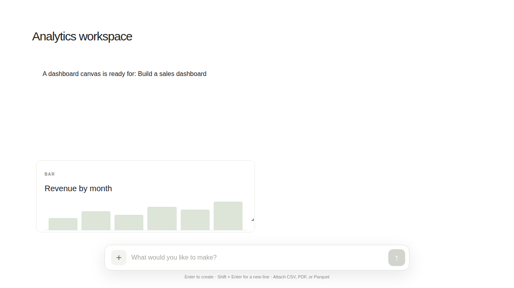

# The Canvasium

The Canvasium is a typed, React-based canvas for composing AI-generated workspaces from text, dashboards, and custom app blocks. It validates proposed changes before applying them, connects widgets to pluggable data sources, and updates only the parts of the canvas that changed.

## Preview

This example workspace is rendered with `CanvasRenderer` and demo connector data:



## What it includes

- **Typed canvas state:** Zod schemas define the normalized canvas, block types, widgets, modes, and data queries.
- **Atomic updates:** A batch of canvas operations either applies in full or leaves the existing state untouched. Untouched blocks retain their object identity.
- **Validated AI responses:** Accepts a decoded response or JSON text (including fenced JSON), validates its operations, and reports parse, JSON, or patch failures.
- **Reactive React renderer:** `CanvasRenderer` subscribes to canvas mode and ordering; each block subscribes to itself so sibling updates do not cause unnecessary block renders.
- **Pluggable data connectors:** A small connector interface supports injected DuckDB executors, Microsoft Graph, vector search, or your own data source.
- **Custom app blocks:** Register React components by `appId` and render them as canvas blocks.

## Project layout

| Path | Purpose |
| --- | --- |
| `src/schema` | Canvas, block, widget, query, and AI-operation schemas |
| `src/state` | Atomic operation reducer and external canvas store |
| `src/router` | AI response parsing, validation, and dispatch |
| `src/connectors` | Connector interface, registry, and DuckDB/Graph/vector adapters |
| `src/ui` | React context, renderer, block components, and connector-query hook |
| `server` | Node API, storage, template planner, AI provider adapter, tracker queries |
| `src/demo`, `src/tracker` | Prompt workspace and tracker UIs |
| `test` | Tests for validation, patching, atomicity, and rendering |

## Two capabilities

| Surface | URL | What it does |
| --- | --- | --- |
| **Prompt workspace** (frontend) | `/` | A chat-style prompt panel for any productivity goal. Generated workspaces persist on the server; use **My History** to revisit prompts and **How It Works** for mode controls and help. |
| **Productivity tracker** (backend UI) | `/tracker` | A Canvasium dashboard of everything done through the app: prompts, success rate, workspaces, blocks, activity by day and category, and recent activity. Auto-refreshes every 15 seconds. |

One Node server (`server/`) serves both pages and a JSON API, records every prompt as a tracked event, and stores data in `data/canvasium.json`.
Use the **Canvas mode** controls in the workspace sidebar to switch between Dashboard, Document, and App layouts.

## Run in GitHub Codespaces

Choose **Code → Codespaces → Create codespace**. The dev container installs dependencies and forwards port `5173`.

```sh
npm run dev
```

Open the forwarded port for the prompt workspace, and add `/tracker` for the tracker. With no AI configured, prompts use built-in offline templates.

## Connect an AI provider (optional)

Any OpenAI-compatible chat-completions endpoint works. Copy `.env.example` to `.env`:

```sh
AI_API_URL=https://api.openai.com/v1/chat/completions
AI_API_KEY=your-key
AI_MODEL=gpt-4o-mini
```

Keys stay on the server. Model output is validated before it changes a workspace; invalid output is rejected (422), provider failures return 502, and both are tracked. Other settings: `PORT` (5173), `HOST` (127.0.0.1), `DATA_FILE` (`data/canvasium.json`).

## API

| Endpoint | Purpose |
| --- | --- |
| `GET /api/health` | Health check |
| `GET /api/workspaces` | List workspaces |
| `GET /api/workspaces/:id` | Load a workspace canvas |
| `POST /api/prompt` | `{ "workspaceId", "prompt" }` (JSON, max 4000 chars) → updated canvas |
| `GET /api/tracker/:statement` | Tracker queries: `prompts`, `success-rate`, `workspaces`, `blocks`, `recent-activity`, `by-category`, `by-day`, `workspace-list` |

**Security:** there is no authentication, and the server binds to `127.0.0.1` by default. Don't expose it publicly without adding auth.

## Run locally

```sh
git clone https://github.com/roime81/The-Canvasium.git
cd The-Canvasium
npm ci
npm run dev      # dev server with HMR on http://localhost:5173
npm start        # build, then serve production bundle
npm run typecheck
npm test
```

To use Canvasium in another application, consume the TypeScript source from this repository; the toolchain must support React, TypeScript, and JSX. The public API is exported from `src/index.ts` and includes `StaticConnector`, `HttpConnector`, `renderBasicMarkdown`, and `CanvasStore.replace`.

## How to use

Create a `CanvasStore`, provide a `ConnectorRegistry` and app registry through `CanvasProvider`, then render `CanvasRenderer`. Use `routeAIResponse` to validate and apply canvas operations:

```tsx
import {
  CanvasProvider,
  CanvasRenderer,
  CanvasStore,
  ConnectorRegistry,
  createEmptyCanvas,
  routeAIResponse,
} from "./src";
import { createRoot } from "react-dom/client";

const store = new CanvasStore(createEmptyCanvas("workspace"));
const connectors = new ConnectorRegistry();

const result = routeAIResponse(store, {
  ops: [
    {
      op: "add_block",
      block: {
        id: "welcome",
        type: "text",
        content: "Welcome to your canvas.",
      },
    },
  ],
});

if (!result.ok) {
  throw new Error(result.error);
}

const root = document.getElementById("root");
if (!root) throw new Error('Missing element with id "root"');

createRoot(root).render(
  <CanvasProvider env={{ store, connectors, apps: {} }}>
    <CanvasRenderer />
  </CanvasProvider>,
);
```

`CanvasProvider` requires a `CanvasStore`, a `ConnectorRegistry`, and an app-component registry. Register data connectors for dashboard queries and React components for custom app blocks. You can optionally provide `renderMarkdown` to render markdown-formatted text blocks; without it, text is displayed as pre-wrapped text.

## Applying AI operations

`routeAIResponse(store, raw)` accepts an object or JSON string with an `ops` array. The optional `intent` and `message` fields can carry application-level context. For example:

```json
{
  "intent": "Create a project dashboard",
  "ops": [
    {
      "op": "add_block",
      "block": {
        "id": "projects",
        "type": "dashboard",
        "columns": 12,
        "widgets": [
          {
            "id": "active-projects",
            "kind": "metric",
            "title": "Active projects",
            "span": 4,
            "query": {
              "connector": "duckdb",
              "statement": "SELECT COUNT(*) AS value FROM projects",
              "params": {}
            }
          }
        ]
      }
    }
  ]
}
```

Supported operations are `add_block`, `update_block`, `remove_block`, `move_block`, `upsert_widget`, `remove_widget`, and `set_mode`. A response may contain up to 100 operations. On failure, the result has `ok: false` and a `stage` of `json`, `parse`, or `patch`; the store is not partially updated. For direct state changes, use `store.dispatch(ops)`, which throws `PatchError` if an operation cannot be applied.

## Blocks and widgets

The built-in block types are:

- **`text`** — plain or markdown-formatted content.
- **`dashboard`** — a 1–12 column grid of metric, table, or chart widgets. Metric widgets show the first value in the first returned row; table and chart widgets currently render tabular results.
- **`app`** — a custom React component selected by `appId`; the component receives its `AppBlock` as a `block` prop.

Widgets can define a `query` with a connector ID, statement, and parameters. `useConnectorQuery` runs the query, exposes loading/error/ready states, and aborts an in-flight request when its query changes or the component unmounts.

## Data connectors

Implement `DataConnector` and register it with the `ConnectorRegistry`. A connector returns column names and rows:

```ts
import { ConnectorRegistry, DuckDbConnector } from "./src";

const connectors = new ConnectorRegistry().register(
  new DuckDbConnector(async (_sql, _params) => {
    // Call your DuckDB runtime here.
    return {
      columns: ["value"],
      rows: [{ value: 42 }],
    };
  }),
);
```

Included adapters:

- **`DuckDbConnector`** delegates SQL and parameters to an injected executor; choose and initialize the DuckDB runtime in your application.
- **`GraphConnector`** calls Microsoft Graph paths with a token supplied by your application.
- **`VectorSearchConnector`** adapts an injected vector index; `params.topK` sets the result count (default `5`).

Connectors own their runtime and authentication setup. The Canvasium does not ship a database, Graph credential flow, vector index, AI model client, or markdown renderer.

## Extending the canvas

To add a block type, add it to the discriminated `BlockSchema` in `src/schema/canvas.ts` and handle it in `renderBlock` in `src/ui/CanvasRenderer.tsx`. The renderer's exhaustive switch makes an unhandled block type a TypeScript error. Update the operation schema/reducer if the new block needs additional editable fields, and add tests for its validation and rendering.

## Development

```sh
npm run typecheck
npm test
```
